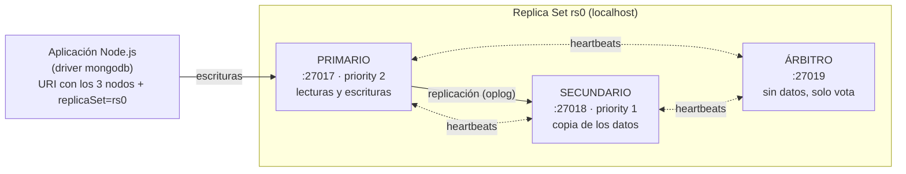

# Fase 3 — Resiliencia, Transacciones y Securización

> Proyecto integrador · MongoDB 8.3 · Node.js (driver `mongodb`) · Windows
> Dominio: **e-commerce** (productos, pedidos y stock — mates de calabaza)

Esta fase transforma una base de datos de desarrollo aislada en un sistema **distribuido, tolerante a fallos, consistente (ACID) y securizado**.

## Contenido del repositorio

| Ruta | Descripción |
|---|---|
| `scripts/init-rs.js` | Inicializa el Replica Set `rs0` |
| `scripts/check-status.js` | Muestra el rol de cada nodo |
| `scripts/insercion-continua.js` | Inserción continua para la prueba de failover |
| `scripts/setup-transaction.js` · `test-transaction.js` · `test-rollback.js` | Transacciones ACID (éxito y fallo) |
| `scripts/create-users.js` · `test-secure.js` | Usuarios, roles y prueba de acceso |
| `config/mongod-{1,2,3}.conf` | Configuración de cada nodo |
| `docs/img/` | Capturas de la ejecución |

---

## 1. Arquitectura del Replica Set



| Nodo | Puerto | Rol | Almacena datos | `dbPath` |
|---|---|---|---|---|
| 0 | 27017 | Primario (priority 2) | Sí | `C:\data\rs0-node1` |
| 1 | 27018 | Secundario (priority 1) | Sí | `C:\data\rs0-node2` |
| 2 | 27019 | Árbitro | No | `C:\data\rs0-node3` |

- Todas las escrituras entran por el Primario y se replican al Secundario a través del **oplog**.
- El Árbitro no guarda datos: aporta un **tercer voto** para que, si cae un nodo con datos, los dos restantes sigan formando mayoría (2 de 3).
- La aplicación se conecta con la lista completa de nodos y `replicaSet=rs0`, por lo que el driver detecta el cambio de Primario automáticamente.

### Inicialización

`scripts/init-rs.js` ejecuta `replSetInitiate` con `directConnection=true` (el set aún no existe). Capturas:


*Resultado:* nodo 27017 `PRIMARY`, 27018 `SECONDARY`, 27019 `ARBITER`. Una inserción de prueba a través del Replica Set confirma la replicación:


### Problemas encontrados durante la puesta en marcha

| Problema | Causa | Solución |
|---|---|---|
| `Cannot find module 'mongodb'` | El script estaba en `C:\` sin el driver instalado | Carpeta `C:\mongo-init` con `npm init` + `npm install mongodb` |
| `Server selection timed out` al inicializar | El set aún no existía y el driver esperaba un Replica Set | Usar `?directConnection=true` en `init-rs.js` |
| `BSONError: Invalid UTF-8 string` en `replSetGetStatus` | Respuesta con datos no UTF-8 desde el servidor en Windows | Se verificó cada nodo por separado (`buildInfo`, conexión directa al 27018) |
| `security.keyFile is required when authorization is enabled with replica sets` | MongoDB exige autenticación interna entre miembros | Ver sección 4 |
| `DBPathInUse` al levantar el nodo 2 | Ya había una instancia usando `C:\data\rs0-node2` | Se detuvo la instancia duplicada |

---

## 2. Bitácora del Failover

Procedimiento ejecutado (`scripts/insercion-continua.js` + caída del Primario):

| Paso | Acción | Qué se espera ver |
|---|---|---|
| 1 | `node scripts/check-status.js` | 27017 PRIMARY · 27018 SECONDARY · 27019 ARBITER |
| 2 | `node scripts/insercion-continua.js` (1 insert/seg, `w: majority`, `retryWrites`) | `insert #n OK` consecutivos |
| 3 | Matar el proceso del Primario (`Stop-Process -Name mongod`/ cerrar la ventana del 27017) | Los inserts se pausan unos segundos |
| 4 | Los otros miembros pierden los heartbeats del Primario (≈10 s, `electionTimeoutMillis`) | El Secundario pide votos; el Árbitro y él mismo votan → mayoría 2 de 3 |
| 5 | El Secundario (27018) pasa a `PRIMARY` | Los inserts se reanudan sin intervención |
| 6 | `node scripts/check-status.js` | 27017 `(not reachable)` · 27018 PRIMARY · 27019 ARBITER |

> 📸 **COMPLETAR:** insertar aquí las capturas de los pasos 2 a 6 (ver `docs/img/`).

---

## 3. Transacciones ACID multi-documento

**Caso de negocio:** compra de un producto. Hay que **descontar el stock** (`productos`) y **registrar el pedido** (`pedidos`) como una sola unidad: si una de las dos operaciones falla, ninguna debe quedar aplicada.

Preparación (`scripts/setup-transaction.js`): producto `mate-calabaza` con `stock: 5`.

### Código comentado (`scripts/test-transaction.js`)

```js
const session = client.startSession();         // las transacciones viven dentro de una sesión
try {
  session.startTransaction();                  // BEGIN

  // 1. Leer el stock dentro de la transacción (snapshot isolation)
  const producto = await db.collection("productos").findOne({ _id: productId }, { session });
  if (!producto || producto.stock < cantidadComprada) {
    throw new Error("¡Stock insuficiente! Abortando transacción.");   // regla de negocio
  }

  // 2. Descontar stock          (pasar { session } vincula la operación a la transacción)
  await db.collection("productos").updateOne(
    { _id: productId }, { $inc: { stock: -cantidadComprada } }, { session });

  // 3. Registrar el pedido
  await db.collection("pedidos").insertOne(
    { productoId: productId, cantidad: cantidadComprada, fecha: new Date(), estado: "Confirmado" },
    { session });

  await session.commitTransaction();           // COMMIT: ambos cambios se hacen visibles a la vez
} catch (error) {
  await session.abortTransaction();            // ROLLBACK: se descarta todo
} finally {
  await session.endSession();                  // libera recursos aunque haya error
}
```

### Escenario de éxito — compra de 2 unidades (stock 5 → 3)


### Escenario de fallo — compra de 10 unidades con stock 3

La regla de negocio se viola a mitad del proceso, se llama a `abortTransaction()` y el stock no se modifica.


| Propiedad | Cómo se cumple |
|---|---|
| **Atomicidad** | `commitTransaction()` / `abortTransaction()`: todo o nada |
| **Consistencia** | La regla "no vender más stock del disponible" se valida dentro de la transacción |
| **Aislamiento** | Snapshot isolation: otras sesiones no ven cambios sin commit |
| **Durabilidad** | Con `writeConcern: majority` el commit sobrevive a la caída de un nodo |

> Las transacciones multi-documento requieren un Replica Set; por eso esta fase depende de la anterior.

---

## 4. Reporte de Securización

### Configuración (`config/mongod-*.conf`)

```yaml
security:
  authorization: "enabled"                   # sin credenciales no se puede operar
  keyFile: "C:\\mongo-init\\mongodb-keyfile" # autenticación interna entre nodos
net:
  bindIp: localhost                          # no escucha en interfaces externas
  port: 27017                                # 27018 / 27019 en los otros nodos
replication:
  replSetName: "rs0"
storage:
  dbPath: "C:\\data\\rs0-node1"
```

Al activar `authorization` en un Replica Set, MongoDB **exige** un `keyFile` para que los nodos se autentiquen entre sí:


### Usuarios y roles (`scripts/create-users.js`)

| Usuario | Base | Roles | Propósito |
|---|---|---|---|
| `adminUser` | `admin` | `userAdminAnyDatabase`, `readWriteAnyDatabase` | Administración de usuarios y mantenimiento |
| `appUser` | `ecommerce` | `readWrite` sobre `ecommerce` | Usado por la aplicación (**privilegios mínimos**) |


### Acceso autenticado


### Rechazo del acceso anónimo

> 📸 **COMPLETAR:** captura de `node scripts/test-secure.js` (segunda parte, "Acceso anónimo RECHAZADO") o de `mongosh` sin credenciales ejecutando `db.getSiblingDB("ecommerce").productos.find()` → `Unauthorized: requires authentication`.

### Justificación

Los secuestros de datos masivos en versiones anteriores se debían a instalaciones **sin autenticación y expuestas a internet**. Esta configuración mitiga esas condiciones:

1. **Autenticación obligatoria** (`authorization: enabled`): una conexión sin credenciales no puede leer ni escribir.
2. **Superficie de red reducida** (`bindIp: localhost`): los nodos no escuchan en interfaces públicas.
3. **Privilegios mínimos**: la aplicación usa `appUser`, que solo puede leer/escribir en `ecommerce`; si se filtra, no puede administrar usuarios ni tocar otras bases.
4. **Autenticación interna** (`keyFile`): un proceso no autorizado no puede unirse al Replica Set.
5. **Credenciales fuera del código**: las contraseñas se pasan por variables de entorno y el keyfile está en `.gitignore`.

**Limitaciones (alcance de un entorno de laboratorio):** no se configuró TLS (el tráfico local no va cifrado) ni cifrado en reposo, y el keyfile es un secreto compartido. En producción se recomienda además TLS, firewall, rotación de credenciales y auditoría.

---

## Cómo ejecutarlo

```powershell
cd C:\mongo-init; npm install mongodb
# 1) levantar los 3 nodos con sus .conf (sin authorization la primera vez) y:
node scripts/init-rs.js
node scripts/check-status.js
# 2) transacciones
node scripts/setup-transaction.js; node scripts/test-transaction.js; node scripts/test-rollback.js
# 3) seguridad
$env:ADMIN_PWD="..."; $env:APP_PWD="..."; node scripts/create-users.js
# luego reiniciar los nodos con authorization + keyFile y:
node scripts/test-secure.js
```
